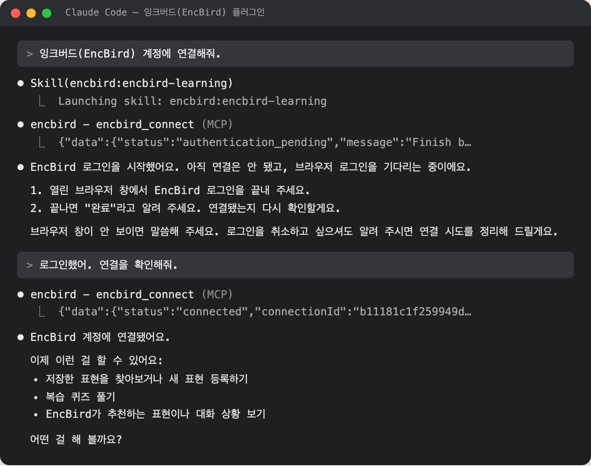
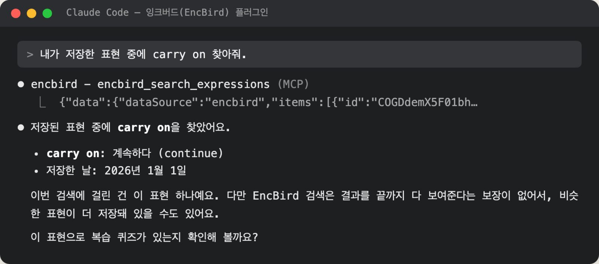
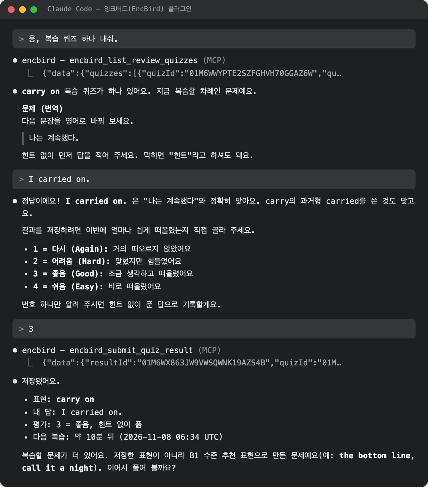
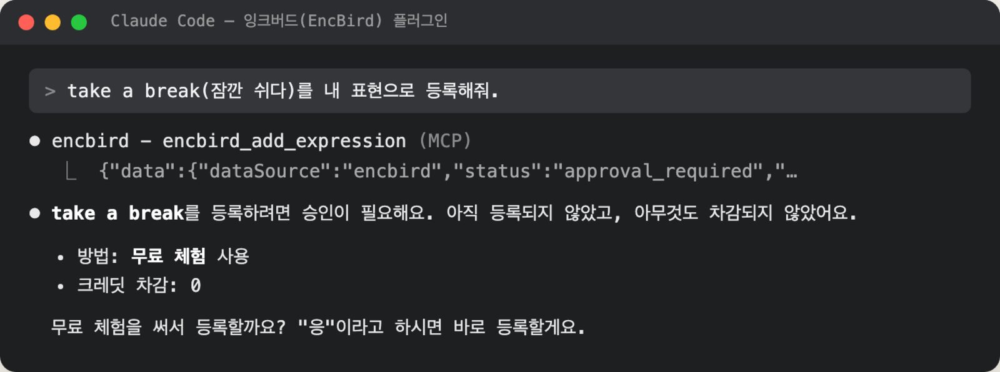

<p align="center">
  <a href="https://encbird.com">
    
  </a>
</p>

<h1 align="center">잉크버드(EncBird) 플러그인</h1>

<p align="center">Codex와 Claude Code에서 대화하듯 영어 표현을 모으고 복습하세요.</p>

<p align="center">
  <a href="LICENSE"></a>
  <a href="https://bun.sh"></a>
</p>

<p align="center">
  <a href="https://encbird.com">잉크버드(EncBird)</a> ·
  <a href="#빠른-시작">빠른 시작</a> ·
  <a href="#사용-예시">사용 예시</a> ·
  <a href="plugins/encbird/README.md">사용·문제 해결 안내</a>
</p>

일하다가 만난 영어 표현을 대화 중에 바로 찾아보고, 복습 퀴즈를 한 문제씩 풀어 보세요. 새 표현과 복습 기록은 [잉크버드(EncBird)](https://encbird.com) 계정에 저장되어 웹에서도 이어서 학습할 수 있습니다.

## 빠른 시작

**Bun 1.4.2 이상**, **macOS 또는 Linux 데스크톱**, 잉크버드(EncBird) 계정, 그리고 Codex 또는 Claude Code가 필요합니다. 로그인은 같은 컴퓨터의 브라우저에서 진행합니다.

### Bun이 없다면 먼저 설치하세요

설치된 버전을 확인합니다.

```sh
bun --version
```

명령을 찾을 수 없거나 1.4.2보다 낮은 버전이라면 [공식 설치 안내](https://bun.sh/docs/installation)에 따라 설치하거나 업데이트하세요.

```sh
curl -fsSL https://bun.sh/install | bash
```

새 터미널에서 `bun --version`을 다시 확인한 뒤 Codex나 Claude Code를 재시작합니다.

<details>
<summary><strong>어시스턴트가 Bun을 찾지 못하면 어떻게 하나요?</strong></summary>

데스크톱 앱이나 다른 셸에서 실행하면 터미널과 실행 경로가 달라 Bun을 찾지 못할 수 있습니다. 새 터미널에서 `bun --version`과 `command -v bun`을 확인하고, Codex나 Claude Code를 완전히 종료했다가 다시 실행하세요. CLI라면 `bun --version`이 동작하는 그 터미널에서 실행하면 됩니다. 플러그인은 Bun을 자동으로 설치하거나 다른 실행 환경으로 바꾸지 않습니다.

</details>

### Codex

```sh
codex plugin marketplace add haandol/encbird-plugin
codex plugin add encbird@encbird
```

### Claude Code

```sh
claude plugin marketplace add haandol/encbird-plugin
claude plugin install encbird@encbird
```

설치한 뒤 새 대화를 시작하고 이렇게 말해 보세요.

> 잉크버드(EncBird) 계정에 연결해줘.

## 사용 예시

아래 화면은 Claude Code에서 이 플러그인을 실제로 실행한 대화 기록입니다. 테스트용 잉크버드(EncBird) 서버와 가상 계정을 사용했고, 대화 내용은 바꾸지 않고 화면으로만 옮겼습니다.

### 계정 연결하기

> 잉크버드(EncBird) 계정에 연결해줘.



열린 브라우저에서 잉크버드(EncBird) 계정으로 로그인하고 돌아와 확인을 요청하면 됩니다. API 키나 서버 주소는 입력하지 않습니다.

### 저장한 표현 찾기

> 내가 저장한 표현 중에 carry on 찾아줘.



### 한 문제씩 복습하기

> 복습 퀴즈 하나 내줘.



답을 확인한 뒤에는 기억 난이도(1~4)를 직접 고릅니다. 어시스턴트가 대신 고르지 않으며, 선택한 난이도에 맞춰 다음 복습 시점이 정해집니다.

### 새 표현 등록하기

> take a break(잠깐 쉬다)를 내 표현으로 등록해줘.



무료 체험이나 크레딧이 필요한 등록은 저장하기 전에 사용 방식과 수량을 먼저 알려 주고 승인을 기다립니다. 승인하면 등록 결과와 차감 여부를 함께 알려 줍니다.

## 알아두면 좋은 내용

<details>
<summary><strong>API 키나 서버 설정이 필요한가요?</strong></summary>

아니요. 브라우저에서 잉크버드(EncBird) 계정으로 로그인하면 연결됩니다. 비밀번호, 인증 토큰, 로그인 후 이동한 URL을 대화에 붙여 넣지 마세요.

</details>

<details>
<summary><strong>크레딧은 언제 사용하나요?</strong></summary>

표현 검색, 복습 퀴즈와 결과 저장, 추천 표현 보기에는 크레딧이 들지 않습니다. 새 표현을 등록할 때 무료 체험이나 크레딧이 필요하면, 어시스턴트가 먼저 안내하고 승인한 뒤에만 등록합니다. 잔액은 [잉크버드(EncBird)](https://encbird.com)에서 확인하고 충전할 수 있습니다.

</details>

<details>
<summary><strong>로그인 정보와 학습 기록은 어디에 저장되나요?</strong></summary>

로그인 정보는 사용 중인 컴퓨터에, 표현과 복습 기록은 잉크버드(EncBird) 계정에 저장됩니다. 이 연결은 Codex·Claude Code 자체 로그인과 별개이며 도구마다 따로 연결합니다. 학습 요청과 답에는 개인정보를 넣지 마세요. 답에 개인정보가 있으면 복습 결과를 저장하지 않고 대화에서만 피드백합니다.

</details>

<details>
<summary><strong>연결을 끊거나 도움을 받으려면요?</strong></summary>

“잉크버드(EncBird) 계정 연결을 해제해줘”라고 요청하고 해제 완료 안내를 확인한 뒤 플러그인을 제거하세요. 플러그인을 제거해도 표현과 복습 기록은 계정에 남습니다. 오류 안내별 대처, 업데이트와 제거 방법은 [사용·문제 해결 안내](plugins/encbird/README.md)에 있습니다. 변경 사항은 [GitHub Releases](https://github.com/haandol/encbird-plugin/releases)에서 확인하세요.

</details>

기여자를 위한 [개발 문서](https://github.com/haandol/encbird-plugin/blob/main/docs/README.md)도 제공합니다.

## 라이선스와 소유권

이 플러그인의 소유권과 저작권은 잉크버드(EncBird)에 있습니다.

Copyright 2026 EncBird. [Apache License 2.0](LICENSE)에 따라 배포합니다.

함께 제공되는 외부 라이브러리는 각각의 라이선스를 따릅니다. 전문은 [외부 라이브러리 라이선스](plugins/encbird/dist/THIRD_PARTY_LICENSES.txt)에 있습니다.
