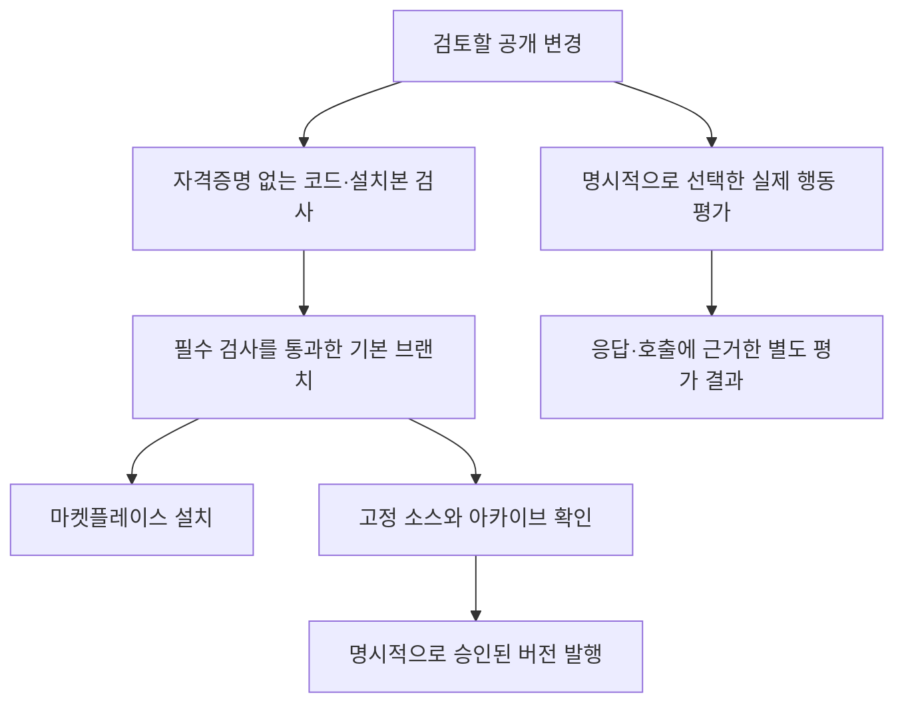

# ADR 0001: 설치 가능한 플러그인의 검증과 발행 경계

Date: 2026-10-28

## Status

Accepted (2026-10-28)

## Purpose

사용자는 마켓플레이스에서 받은 플러그인으로 계정을 연결하고 표현과 복습을 저장한다. 공개 기본 브랜치도 설치 대상이므로, 버전 태그를 발행하는 시점의 검사만으로 모든 설치본을 확인할 수는 없다. 소비자가 실행할 파일과 문서가 검증된 소스에 일치하도록 일반 변경과 버전 발행에 검증 조건을 둔다.

도구의 입력 검증만으로 에이전트가 사용자의 비용 승인이나 평점 선택을 기다렸는지는 알 수 없다. 이 행동은 실제 도구 호출과 사용자에게 보이는 응답으로 따로 평가하되, 기본 검증이 유료 모델이나 실제 학습 계정을 사용하지 않도록 분리한다.

## Decision Drivers

- 설치될 파일을 재생성한 결과로 원래 설치본의 실행 가능성을 대신 증명할 수 없다.
- 공개 변경은 재현 가능한 검사로 검증하고, 실제 모델 평가는 비용과 비결정성을 명시적으로 선택해야 한다.
- 검증 코드에 발행 자격증명을 전달하면 검사 자체가 외부 쓰기 권한을 갖게 된다.
- 문서와 스킬의 경로도 설치 후에 사용할 수 있어야 하며, 결과 보고는 실제 확인한 범위를 유지해야 한다.

## Decision

공개 플러그인의 기본 브랜치는 검토 요청과 자동 코드·배포본 검증을 통해 갱신한다. 로컬 푸시 검사와 원격 필수 검사는 같은 검증 의무를 확인한다. 버전 발행은 검증된 소스·주석 태그·아카이브를 고정하며, 발행 자격증명은 외부 쓰기를 수행하는 단계에만 전달한다.

기본 검증은 합성 자료와 가짜 외부 응답을 사용한다. 선택적으로 수행하는 실제 에이전트 평가는 시험 도구로 작업 범위를 제한하고 원래 응답과 호출 증거를 남긴다. 모델의 판단 결과는 자동 코드 검사의 성공과 구분해 보고한다.

### Requirement contract

#### Required guarantees

| 의무 | Observable evidence |
| --- | --- |
| 기본 브랜치 갱신은 검토 요청과 코드 검사·빌드 일치·설치 런타임 검사의 성공을 요구한다. | 실패하거나 완료되지 않은 필수 검사를 성공으로 처리해 기본 브랜치에 합치지 않는다. |
| 검증은 실제 푸시하거나 발행할 소스 전체에 결합한다. | 다른 소스나 검사 정의에는 이전 성공을 적용하지 않는다. 검사 도중 소스가 바뀌면 해당 성공 증거가 생기지 않는다. |
| 배포된 실행 파일은 개발 의존성을 설치하지 않은 상태에서 동작한다. 지원 하한 Node 22.12.0에서도 검증한다. | 설치본으로 초기화와 도구 발견·스크립트 진입점을 실행할 수 있다. |
| 커밋된 설치본의 실행과 재생성 결과의 일치를 각각 확인한다. | 재생성이 고친 파일만 검사해 오래되거나 손상된 커밋의 파일을 통과시키지 않는다. |
| 동봉한 문서·스킬의 로컬 참조는 같은 설치본에 존재한다. | 설치본 밖을 가리키는 상대 링크나 누락 파일을 발견해 발행 준비를 중단한다. |
| 로컬 푸시와 버전 발행은 프로젝트 컨테이너에서 실행한다. | 호스트나 표식만 흉내 낸 다른 실행 환경의 요청을 거부한다. |
| 실제 에이전트 평가는 비용 승인·실제 답변과 평점·개인정보·원래 요청과 작업 키의 보존을 관찰 가능한 증거로 확인한다. | 사용자 응답 전의 쓰기 시도나 근거 없는 성공 보고가 호출과 응답 기록에서 드러난다. |

#### Prohibitions

| 의무 | Observable evidence |
| --- | --- |
| 기본 검사와 평가 준비는 실제 모델을 호출하거나 실제 학습 계정의 자료·크레딧을 변경하지 않는다. | 별도 실제 실행 의사가 없는 작업은 준비 또는 가짜 실행 검증으로 끝난다. |
| 검사·빌드·평가에는 발행 자격증명을 전달하지 않는다. | 인증된 푸시 중 검증이 필요하면 자격증명 없는 검증을 먼저 요구하거나 이미 확인한 같은 소스의 증거를 확인한다. |
| 실제 모델 호출은 운영자가 명시적으로 선택하며, 자동 코드 검사의 필수 조건으로 삼지 않는다. | 실제 실행을 선택하지 않은 결과는 미실행이며 모델 평가 부재를 코드 검사 성공으로 숨기지 않는다. |
| 평가 대상 에이전트는 합성 시험 자료와 허용된 시험 도구만 사용한다. | 사용자 저장소·자격증명·외부 학습 서비스에 대한 임의 접근을 평가 도구로 실행하지 못한다. |
| 평가는 관찰 가능한 출력과 행동을 판단하고 모델의 내부 사고 기록을 요구하지 않는다. | 판단 근거가 실제 응답·호출·결과에 연결되며 자기 보고만으로 성공하지 않는다. |
| 기존 태그·발행 자산·서로 다른 준비 결과를 덮어쓰지 않는다. | 버전·소스·해시 충돌은 쓰기 전에 거부된다. |

#### Failure guarantees

| 의무 | Observable evidence |
| --- | --- |
| 원격 필수 검사는 해당 검사 정의와 성공 경로가 원격에서 확인된 뒤에 적용한다. | 존재하지 않는 검사만 요구해 기본 브랜치를 막는 설정을 적용하지 않는다. |
| 발행 중 일시적인 조회 불일치는 같은 대상을 읽는 유한한 재확인으로 처리한다. | 초안 생성이나 업로드를 맹목적으로 반복하지 않으며, 확인할 수 없으면 기존 결과를 남기고 중단한다. |
| 실제 평가의 알려진 위반·누락 증거·실행 오류·미실행을 구분한다. | 높은 집계 점수가 필수 위반을 가리지 않으며, 확인하지 못한 항목이 통과로 변하지 않는다. |
| 평가 실패와 중단에서도 이미 수집한 응답·호출 증거를 보존한다. | 새 결과로 원래 기록을 덮어쓰지 않고 실제 확인 범위로 후속 검토를 할 수 있다. |

### Alternatives

버전 발행 시점의 수동 검증만 사용하면 관리할 자동화는 적지만, 기본 브랜치로 설치하는 경로의 검증이 빠진다. 기본 브랜치와 발행 양쪽의 재현 가능한 검사를 채택해 같은 소스의 설치 가능성을 확인한다.

실제 모델 평가를 모든 변경의 필수 검사로 삼으면 행동 문제를 자주 관찰할 수 있지만 비용·외부 가용성·판정 변동이 일반 변경을 막는다. 가짜 실행으로 평가 하네스 자체를 검사하고, 실제 모델 평가는 명시적으로 선택하는 방식을 채택한다.

## Consequences

코드와 문서의 작은 변경에도 설치될 실행 파일과 참조 경로를 확인할 수 있다. 컨테이너 준비와 자동 검사 시간이 들며, 소스가 바뀌면 그에 맞는 검증을 다시 수행해야 한다. 로컬 증거는 운영자의 작업 흐름을 돕는 장치이며 원격 검사를 대신하는 보편적인 기계 신뢰 증명은 아니다.

실제 모델 평가는 관찰한 시나리오와 실행 조건의 결과를 남긴다. 제한된 도구와 기록 검증은 운영자가 신뢰하는 실행 클라이언트를 전제로 하며, 임의의 실행 프로그램을 운영체제 수준에서 격리했다고 주장하지 않는다. 중단된 외부 모델 요청의 과금 종료까지 로컬 프로세스 종료만으로 보장하지 않는다.

## Related

- [Development and validation](../../development.md)
- [Versioned releases](../../releases.md)
- [Plugin runtime](../../runtime.md)
